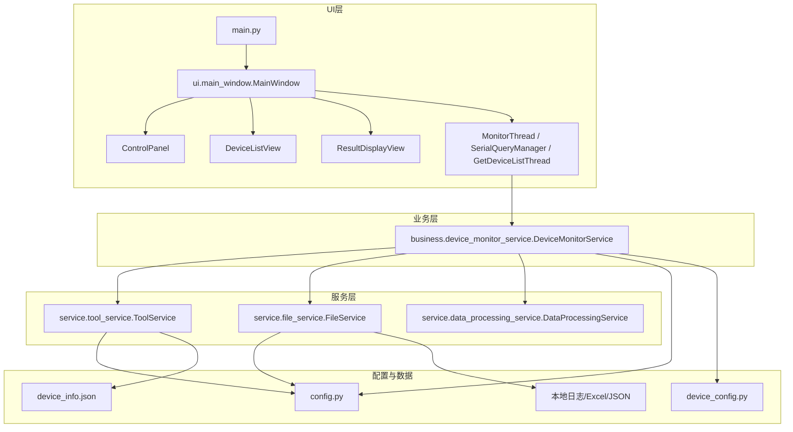
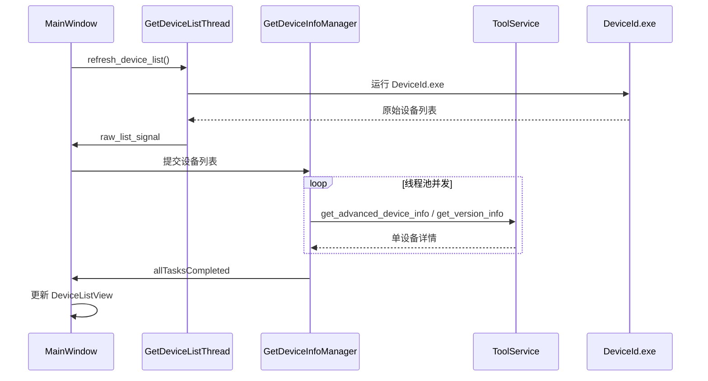
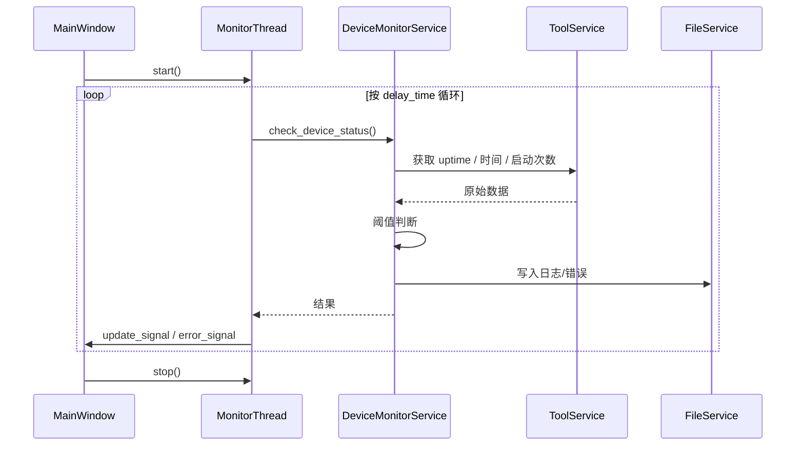
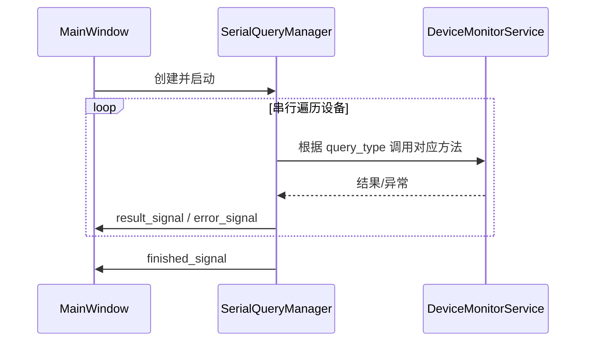

# 项目优化报告

> **分析范围**：`d:\log_monitor\20260224` 全部源码（Python）及相关配置文件  
> **分析方式**：静态代码审查，未执行运行时调试  
> **报告目的**：梳理项目功能与结构层级，针对模块设计、方法实现、类结构、事件处理、操作逻辑、变量使用六个维度提出可落地的优化建议。

---

## 1. 执行摘要

本项目是一款基于 **PyQt5 + Python 3** 的桌面设备监控工具，主要用于对安卓/Linux 播放设备进行：

- 设备发现与列表刷新
- 运行时间、设备时间、启动次数监控
- 开关机日志收集与统计
- 节目文件初始化/升级
- 截图、Excel 导出、错误日志告警

当前项目已按 `ui / business / service / config / tools` 初步分层，但存在以下核心问题：

1. **类职责过重**：`MainWindow`、`DeviceMonitorService`、`ToolService` 均承担过多职责，形成“上帝类”。
2. **重复代码与硬编码**：设备类型判断、远程路径、输出目录、超时时间等散落在多个文件中。
3. **异常处理薄弱**：大量 `except Exception: pass` 或返回字符串，错误状态被掩盖。
4. **事件/线程安全隐患**：共享可变对象跨线程传递、worker 线程直接操作 UI、信号未断开导致重复连接。
5. **配置与命名不规范**：全局变量命名风格混乱，缺少类型注解，魔法数字较多。

本报告将按六个维度逐一分析，并给出分阶段实施建议。

---

## 2. 项目结构与技术栈

### 2.1 目录结构

```text
d:\log_monitor\20260224
├── main.py                      # GUI 入口
├── config.py                    # 全局配置（版本、路径、阈值、设备类型）
├── device_config.py             # 从 device_info.json 加载设备型号配置
├── device_checker.py            # 命令行设备诊断工具
├── read_log.py                  # 读取错误日志的小脚本
├── setup.py / pyinstaller_spec.py  # 打包配置
├── business/
│   └── device_monitor_service.py   # 核心业务编排
├── service/
│   ├── tool_service.py          # ADB/SSH/PSCP/设备发现等外部工具封装
│   ├── file_service.py          # 文件读写、日志持久化
│   └── data_processing_service.py  # 数据解析与格式化
└── ui/
    ├── base_window.py           # 基础主窗口框架
    ├── main_window.py           # 主窗口与总控制器（约 1700 行）
    ├── control_panel.py         # 顶部控制面板
    ├── device_list_view.py      # 设备表格视图
    ├── result_display_view.py   # 日志/结果显示
    ├── monitor_thread.py        # 监控后台线程
    ├── query_thread.py          # 单设备查询线程（已弃用）
    ├── serial_query_manager.py  # 串行查询管理器
    ├── reflash_device_thread.py # 旧版刷新线程（已弃用）
    └── reflash_device_threadpool.py  # 线程池版设备信息获取
```

> 说明：指定要分析的 `service/task_queue_service.py`、`service/logging_service.py`、`service/resource_service.py`、`service/async_command_service.py`、`ui/device_scan_thread.py` 在当前项目中不存在。

### 2.2 技术栈

- **GUI**：PyQt5（`QMainWindow`、`QThread`、`QThreadPool`、`pyqtSignal`）
- **设备通信**：`adb.exe`、`plink.exe`/`pscp.exe`（SSH/SCP）、`DeviceId.exe`、`HPassword.exe`
- **数据处理**：`pandas`、`openpyxl`
- **打包**：`PyInstaller` + `setuptools`

---

## 3. 架构与数据流分析

### 3.1 分层架构



### 3.2 核心数据流

#### 设备发现流



#### 监控业务流



#### 查询/操作流



---

## 4. 详细优化建议

### 4.1 模块设计

#### 4.1.1 配置模块职责混杂、命名风格不统一

- **问题位置**：[config.py](file:///d:/log_monitor/20260224/config.py) 全模块，典型行：
  - 第 19 行 `getinfo_path`
  - 第 22 行 `supported_dev_types`（全局可变列表）
  - 第 29 行 `default_dev_type`
  - 第 39 行 `get_base_dir()` 使用 `__file__` 而非 `PROJECT_ROOT`
- **问题描述**：常量、函数、运行时路径、魔法数字混放一个文件；命名未遵循 PEP 8（常量应全大写）；`get_base_dir()` 未复用 `PROJECT_ROOT`，PyInstaller 单文件模式下会指向临时目录。
- **优化步骤**：
  1. 将 `config.py` 拆分为 `constants.py`（纯常量）、`paths.py`（路径计算，统一基于 `get_project_root()`）、`settings.py`（可运行时修改的阈值/间隔）。
  2. 所有常量改为 `UPPER_SNAKE_CASE`，如 `GET_INFO_PATH`、`SUPPORTED_DEV_TYPES`（改为元组）、`DEFAULT_DEV_TYPE`、`DEFAULT_DELAY_SECONDS`。
  3. 将 `60`、`120`、`3` 等魔法数字提升为具名常量。
  4. 修正 `get_base_dir()` 统一使用 `PROJECT_ROOT`。
- **预期效果**：配置职责清晰、打包后路径一致、减少误改。
- **潜在风险**：拆分后旧代码导入路径变化，需全局替换；可通过保留兼容性别名降低风险。
- **兼容性/可维护性**：高兼容性；后续新增设备类型或阈值只需改一处。

#### 4.1.2 `device_config.py` 全局缓存与同质化函数

- **问题位置**：[device_config.py](file:///d:/log_monitor/20260224/device_config.py) 第 18 行起 `_load_device_info`、第 43 行起 `get_device_config` 等系列函数。
- **问题描述**：模块级全局缓存无法隔离状态；`get_init_config`、`get_upgrade_config`、`get_otg_config` 等函数高度同质化，仅读取字典不同中文字段。
- **优化步骤**：
  1. 封装为 `DeviceConfigRepository` 类，支持显式 `load()`/`reload()`，便于测试与并发隔离。
  2. 将同质化读取函数合并为 `get_field(device_type, field_name, default=None)`，并定义常量键名表。
  3. `get_init_grouped_configs` / `get_upgrade_grouped_configs` 提取公共分组函数，使用 `namedtuple`/`dataclass` 作为分组键。
- **预期效果**：减少重复代码，缓存状态可控。
- **潜在风险**：调用方需从函数调用改为实例方法；可保留模块级单例兼容旧代码。
- **兼容性/可维护性**：接口可平滑过渡，后续型号配置扩展更容易。

#### 4.1.3 `device_checker.py` 职责过重

- **问题位置**：[device_checker.py](file:///d:/log_monitor/20260224/device_checker.py) 第 31 行 `DeviceChecker` 类、第 748 行 `main()`。
- **问题描述**：一个类/函数同时承担 CLI 参数解析、交互式输入、SSH 连接、系统识别、各项指标检查、结果汇总与输出。
- **优化步骤**：
  1. 拆分为 `DeviceInspector`（纯检查逻辑，返回结构化结果）、`ReportFormatter`（文本/CSV/JSON 输出）、`CLI`（参数解析与交互输入）。
  2. `main()` 拆分为 `parse_args()`、`resolve_metrics()`、`interactive_input()`、`run_check()`。
  3. 各 `check_*` 方法统一返回 `CheckResult` 数据类，而非仅打印。
- **预期效果**：单元测试可行、新增检查指标只需扩展策略。
- **潜在风险**：CLI 输出格式变化可能影响外部脚本；保持默认文本格式即可兼容。
- **兼容性/可维护性**：命令行交互层独立后更稳定。

#### 4.1.4 服务层“胖类”需要拆分

- **问题位置**：
  - [service/tool_service.py](file:///d:/log_monitor/20260224/service/tool_service.py) 第 73 行 `ToolService`（1374 行）
  - [business/device_monitor_service.py](file:///d:/log_monitor/20260224/business/device_monitor_service.py) 第 15 行 `DeviceMonitorService`
- **问题描述**：`ToolService` 同时封装 ADB、SSH、PSCP、MD5、设备发现、OTG；`DeviceMonitorService` 同时承担初始化、升级、监控、截图、日志导出。
- **优化步骤**：
  1. `ToolService` 拆分为 `AdbService`、`SshService`、`FileTransferService`、`DeviceDiscoveryService`、`OtgService`。
  2. `DeviceMonitorService` 拆分为 `DeviceInitService`、`DeviceLogService`、`DeviceTimeService`、`ScreenshotService`、`MonitorCoordinator`。
  3. 在业务类中通过构造函数注入所需服务实例，而非直接调用静态方法。
- **预期效果**：每个服务职责单一、依赖关系显式、便于 mock 测试。
- **潜在风险**：拆分初期调用链变长；可通过 facade 类提供常用组合接口过渡。
- **兼容性/可维护性**：中短期增加文件数，但长期维护成本显著降低。

#### 4.1.5 UI 层上帝类与重复实现

- **问题位置**：
  - [ui/main_window.py](file:///d:/log_monitor/20260224/ui/main_window.py) 第 506 行 `MainWindow`
  - [ui/query_thread.py](file:///d:/log_monitor/20260224/ui/query_thread.py) 与 [ui/serial_query_manager.py](file:///d:/log_monitor/20260224/ui/serial_query_manager.py)
  - [ui/reflash_device_thread.py](file:///d:/log_monitor/20260224/ui/reflash_device_thread.py)
- **问题描述**：`MainWindow` 约 1700 行，承担窗口管理、业务编排、Excel 导出、错误日志、设备刷新、对话框创建；`QueryThread` 与 `SerialQueryManager` 功能重复；`ReflashThread` 已废弃。
- **优化步骤**：
  1. 将 `CountInitConfirmDialog`、`UpgradeConfirmDialog` 移至 `ui/dialogs/` 独立文件。
  2. Excel 导出、错误日志管理、设备刷新流程拆分为 `ExcelExporter`、`ErrorLogManager`、`DeviceRefreshController`。
  3. 统一查询执行模型，删除 `QueryThread`；确认 `ReflashThread` 无用后删除。
- **预期效果**：`MainWindow` 只负责视图组装与信号路由，代码量大幅下降。
- **潜在风险**：移动对话框会改变导入路径；使用批量替换即可。
- **兼容性/可维护性**：UI 层更清晰，后续新增视图/对话框更容易。

---

### 4.2 方法实现

#### 4.2.1 超长方法需拆分

- **问题位置**：
  - [business/device_monitor_service.py](file:///d:/log_monitor/20260224/business/device_monitor_service.py#L529-L795) `check_device_status`
  - [ui/main_window.py](file:///d:/log_monitor/20260224/ui/main_window.py#L702-L917) `start_monitor`
  - [ui/monitor_thread.py](file:///d:/log_monitor/20260224/ui/monitor_thread.py#L31-L173) `run`
  - [service/file_service.py](file:///d:/log_monitor/20260224/service/file_service.py#L74-L196) `write_error_log`
  - [device_checker.py](file:///d:/log_monitor/20260224/device_checker.py#L748-L921) `main`
- **问题描述**：方法同时完成多项任务，局部变量众多、嵌套深、难以单测。
- **优化步骤**：
  1. `check_device_status` 拆分为 `check_uptime()`、`check_device_time()`、`check_start_count()`、`write_monitor_logs()`、`update_device_state()`。
  2. `start_monitor` 拆分为 `pre_check_devices()`、`build_summary()`、`confirm_start()`、`launch_monitor_thread()`。
  3. `MonitorThread.run` 拆分为 `_process_one_device()`、`_sleep_with_countdown()`。
  4. `write_error_log` 拆分为 `_format_error_detail()` + 写入。
  5. `device_checker.main()` 拆分为解析、交互、执行、输出四个函数。
- **预期效果**：每个函数职责单一，圈复杂度下降，便于单元测试。
- **潜在风险**：过度拆分可能导致调用栈过深；保持同一类/模块内聚即可。
- **兼容性/可维护性**：公共入口方法签名保持不变，内部重构对调用方透明。

#### 4.2.2 减少嵌套与分支，使用卫语句与分发

- **问题位置**：
  - [business/device_monitor_service.py](file:///d:/log_monitor/20260224/business/device_monitor_service.py#L529-L795) `check_device_status` 存在 5 层以上嵌套
  - [ui/serial_query_manager.py](file:///d:/log_monitor/20260224/ui/serial_query_manager.py#L24-L159) 大量 `if self.query_type == ...`
  - [device_checker.py](file:///d:/log_monitor/20260224/device_checker.py#L606-L695) `check_device_by_metrics` 使用 lambda 字典但签名不一致
- **优化步骤**：
  1. 使用卫语句提前返回，避免深层 `if` 嵌套。
  2. 对任务类型使用策略模式或统一签名的分发字典：`QUERY_HANDLERS[query_type](device)`。
  3. 对系统类型路径判断统一封装为 `get_switch_log_path(system_type)`、`get_program_path(system_type)`。
- **预期效果**：逻辑扁平化，新增任务类型只需注册 handler。
- **潜在风险**：lambda/函数引用不一致问题需统一参数列表。
- **兼容性/可维护性**：保持行为不变，仅调整实现方式。

#### 4.2.3 返回值结构化和异常策略

- **问题位置**：
  - [business/device_monitor_service.py](file:///d:/log_monitor/20260224/business/device_monitor_service.py#L26-L429) `count_init_setting`、`upgrade_program`、`ntptime_checkout_time` 等返回字符串表示成功/失败
  - [business/device_monitor_service.py](file:///d:/log_monitor/20260224/business/device_monitor_service.py#L151-L237) `sum_switch_count` 异常时返回 `(0, 0, True, None)`
  - [service/tool_service.py](file:///d:/log_monitor/20260224/service/tool_service.py) 多处 `except Exception: pass`
- **问题描述**：调用方只能解析字符串判断结果，无法区分“文件不存在”与“通信失败”；静默吞异常导致问题难定位。
- **优化步骤**：
  1. 引入 `Result[T, E]` 数据类或自定义异常体系（如 `DeviceConnectError`、`CommandExecutionError`）。
  2. 业务方法返回结构化对象：`OperationResult(success, data, error)`。
  3. 区分可恢复异常与致命异常；记录 warning/error 日志及完整堆栈。
  4. `sum_switch_count` 中区分“日志不存在 → 计数为 0”与“命令失败 → 返回错误”。
- **预期效果**：错误状态明确，便于后续自动化测试与日志审计。
- **潜在风险**：返回类型变化影响 `MainWindow` 信号槽；需同步修改接收端。
- **兼容性/可维护性**：提供兼容包装函数过渡，如 `legacy_do_x()` 仍返回字符串。

#### 4.2.4 长参数列表需封装

- **问题位置**：
  - [ui/monitor_thread.py](file:///d:/log_monitor/20260224/ui/monitor_thread.py#L13-L31) `MonitorThread.__init__` 有 13 个参数
  - [ui/control_panel.py](file:///d:/log_monitor/20260224/ui/control_panel.py#L187-L209) `start_monitor_clicked` 发射 6 个参数
- **优化步骤**：
  1. 定义 `MonitorConfig`/`MonitorOptions` 数据类。
  2. `ControlPanel` 提供 `monitor_options()` 方法返回配置对象。
  3. `MonitorThread` 接收单一配置对象。
- **预期效果**：参数清晰、扩展方便。
- **潜在风险**：信号参数类型变化；可通过 `pyqtSignal(object)` 传递数据类。
- **兼容性/可维护性**：高。

---

### 4.3 类结构

#### 4.3.1 静态工具类不利于测试与扩展

- **问题位置**：
  - [service/tool_service.py](file:///d:/log_monitor/20260224/service/tool_service.py#L73) `ToolService`
  - [service/file_service.py](file:///d:/log_monitor/20260224/service/file_service.py#L17) `FileService`
  - [service/data_processing_service.py](file:///d:/log_monitor/20260224/service/data_processing_service.py#L7) `DataProcessingService`
- **问题描述**：全静态方法类无法通过依赖注入替换实现，单元测试难以 mock。
- **优化步骤**：
  1. 将关键服务改为实例类，定义抽象接口（如 `IDeviceTransport`、`IFileService`、`INotificationService`）。
  2. `AdbTransport`、`SshTransport` 实现 `IDeviceTransport`。
  3. 业务类通过构造函数注入服务实例：`DeviceMonitorService(transport, file_service, log_service)`。
- **预期效果**：可 mock 依赖编写单元测试，未来支持新传输协议只需新增实现类。
- **潜在风险**：重构幅度大，需同步修改所有调用方。
- **兼容性/可维护性**：长期收益显著；可在重构过程中保留静态 facade 作为过渡。

#### 4.3.2 `MainWindow` 上帝类治理

- **问题位置**：[ui/main_window.py](file:///d:/log_monitor/20260224/ui/main_window.py#L506-L1770) `MainWindow`
- **问题描述**：承担视图组装、业务编排、Excel 导出、错误日志、历史清理、对话框创建等多重职责。
- **优化步骤**：
  1. 提取 `ExcelExporter` 处理 [export_monitor_results_to_excel](file:///d:/log_monitor/20260224/ui/main_window.py#L1308-L1464)。
  2. 提取 `ErrorLogManager` 处理 [write_to_error_log](file:///d:/log_monitor/20260224/ui/main_window.py#L599-L634)、[open_error_log_in_notepad](file:///d:/log_monitor/20260224/ui/main_window.py#L1468-L1490)。
  3. 提取 `DeviceRefreshController` 处理 [refresh_device_list](file:///d:/log_monitor/20260224/ui/main_window.py#L1609-L1648) 流程。
  4. 对话框类 [CountInitConfirmDialog](file:///d:/log_monitor/20260224/ui/main_window.py#L30-L293)、[UpgradeConfirmDialog](file:///d:/log_monitor/20260224/ui/main_window.py#L293-L506) 移到 `ui/dialogs/`。
- **预期效果**：`MainWindow` 仅保留视图组装与信号路由，代码量减半。
- **潜在风险**：拆分时需小心信号连接生命周期。
- **兼容性/可维护性**：UI 层结构更清晰。

#### 4.3.3 设备状态裸字典应封装为数据类

- **问题位置**：[business/device_monitor_service.py](file:///d:/log_monitor/20260224/business/device_monitor_service.py) `self.device_data`
- **问题描述**：键名如 `'initial_time_diff'`、`'last_card_time'` 分散在多个方法中直接读写，容易拼写错误。
- **优化步骤**：
  1. 定义 `DeviceState`/`DeviceMonitorRecord` dataclass。
  2. 将 `device_data` 改为 `Dict[str, DeviceState]`，所有访问通过属性。
  3. 序列化/反序列化由 `FileService` 统一处理。
- **预期效果**：字段访问安全、可类型检查。
- **潜在风险**：JSON 文件格式保持不变即可兼容历史数据。
- **兼容性/可维护性**：数据类可与 JSON 字典互转，兼容历史文件。

#### 4.3.4 通知能力应与监控逻辑解耦

- **问题位置**：[business/device_monitor_service.py](file:///d:/log_monitor/20260224/business/device_monitor_service.py) `self.notepad_process`
- **问题描述**：监控类内部管理 Windows 记事本进程，与核心业务无关。
- **优化步骤**：
  1. 抽象 `NotificationService` 接口。
  2. 提供 `DesktopNotificationService`、`NotepadNotificationService` 等实现。
  3. 注入到 `MonitorCoordinator` 中。
- **预期效果**：告警方式可替换、可关闭。
- **潜在风险**：低。
- **兼容性/可维护性**：保持默认记事本行为即可兼容现有用户习惯。

---

### 4.4 事件处理逻辑

#### 4.4.1 Worker 线程严禁直接操作 UI

- **问题位置**：
  - [ui/reflash_device_thread.py](file:///d:/log_monitor/20260224/ui/reflash_device_thread.py#L14) `run` 中直接调用 `self.control_panel.update_refresh_status(...)` 与 `self.control_panel.refresh_button.setEnabled(True)`
  - [ui/main_window.py](file:///d:/log_monitor/20260224/ui/main_window.py#L702-L917) `start_monitor` 在主线程同步调用 `check_device_status` 与 `capture_screenshot`
- **问题描述**：跨线程直接访问 UI 控件会导致 Qt 崩溃或界面卡死；主线程同步预检查会阻塞 UI。
- **优化步骤**：
  1. `ReflashThread` 通过 `pyqtSignal` 发射状态信号，由主线程槽函数更新控件。
  2. 将 `start_monitor` 中的预检查逻辑移入 `MonitorThread` 或单独的 `PreCheckThread`，主线程仅展示进度条。
  3. 所有耗时操作必须放在 worker 线程。
- **预期效果**：消除界面无响应与潜在崩溃。
- **潜在风险**：信号参数/槽函数调整需仔细测试。
- **兼容性/可维护性**：符合 Qt 最佳实践。

#### 4.4.2 避免共享可变对象跨线程传递

- **问题位置**：
  - [ui/main_window.py](file:///d:/log_monitor/20260224/ui/main_window.py#L1690-L1713) `self.devices` 在 `refresh_device_flash` 中被多线程 `append`
  - [ui/main_window.py](file:///d:/log_monitor/20260224/ui/main_window.py#L1053-L1146) `query_count = [0]` 作为可变列表传入线程
  - [ui/main_window.py](file:///d:/log_monitor/20260224/ui/main_window.py#L1053-L1146) `switch_log_file` 文件对象传入 `SerialQueryManager` 在工作线程写入
- **问题描述**：多线程读写共享可变对象存在数据竞争；文件句柄跨线程写入未加锁。
- **优化步骤**：
  1. 使用信号传递不可变数据，避免 `MainWindow.devices` 被 worker 直接修改。
  2. 计数器使用线程安全对象（如 `QAtomicInt`、带锁的整数对象），或仅通过信号回传增量。
  3. 文件写入由主线程统一处理，或在工作线程中使用 `QMutex`/`QMutexLocker` 保护。
- **预期效果**：消除并发 Bug。
- **潜在风险**：改为信号传递会增加少量主线程负担；设备数量大时考虑批量回传。
- **兼容性/可维护性**：信号/槽机制本身线程安全。

#### 4.4.3 信号连接生命周期管理

- **问题位置**：
  - [ui/main_window.py](file:///d:/log_monitor/20260224/ui/main_window.py#L571-L589) `connect_signals_slots`
  - [ui/main_window.py](file:///d:/log_monitor/20260224/ui/main_window.py#L1609-L1648) `refresh_device_list` 每次创建新线程并连接信号
- **问题描述**：旧线程信号连接未断开，重复创建线程时可能导致同一个槽被多次触发。
- **优化步骤**：
  1. 在重新创建线程前调用 `old_thread.disconnect()` 或保存连接对象后断开。
  2. 对一次性线程使用 `deleteLater()`。
  3. 将 `connect_signals_slots` 拆分为永久连接与动态连接两部分。
- **预期效果**：避免信号重复触发、野指针。
- **潜在风险**：断开不存在连接会报错，需使用 `try/except` 或判断 `receivers()`。
- **兼容性/可维护性**：高。

#### 4.4.4 复选框/全选事件处理优化

- **问题位置**：
  - [ui/device_list_view.py](file:///d:/log_monitor/20260224/ui/device_list_view.py#L174-L197) `on_device_selected` 基于 `cellClicked`
  - [ui/device_list_view.py](file:///d:/log_monitor/20260224/ui/device_list_view.py#L198-L217) `on_select_all_changed` 直接赋值 `self.selected_devices_info = self.devices`
- **问题描述**：`cellClicked` 对复选框状态变化不可靠；全选赋值引用导致取消单个设备时可能修改原始列表。
- **优化步骤**：
  1. 使用 `itemChanged` 信号监听复选框状态变化，统一维护 `selected_devices_info`。
  2. 全选时使用浅拷贝：`self.selected_devices_info = self.devices.copy()`。
  3. 提取“保存选择状态”与“恢复选择状态”为私有方法。
- **预期效果**：选择状态准确、稳定。
- **潜在风险**：低。
- **兼容性/可维护性**：用户交互体验改善。

#### 4.4.5 任务类型字符串参数应使用枚举

- **问题位置**：[ui/control_panel.py](file:///d:/log_monitor/20260224/ui/control_panel.py#L117-L182) `create_query_control` 中多个 `lambda: self.query_selected_clicked.emit("...")`
- **问题描述**：字符串参数分散，容易拼写错误。
- **优化步骤**：
  1. 定义 `QueryType(Enum)`：
     ```python
     class QueryType(Enum):
         TIME = "time"
         UPTIME = "uptime"
         START_COUNT = "start_count"
         ...
     ```
  2. 在 lambda 中使用 `QueryType.TIME.value`。
- **预期效果**：避免拼写错误，IDE 可自动补全。
- **潜在风险**：枚举值需与现有字符串完全一致。
- **兼容性/可维护性**：完全兼容现有逻辑。

---

### 4.5 操作逻辑

#### 4.5.1 异常处理策略整体升级

- **问题位置**：
  - [service/tool_service.py](file:///d:/log_monitor/20260224/service/tool_service.py) 多处 `except Exception: pass`
  - [business/device_monitor_service.py](file:///d:/log_monitor/20260224/business/device_monitor_service.py) 大量 `try...except Exception` 后返回字符串
  - [device_checker.py](file:///d:/log_monitor/20260224/device_checker.py) 所有 `check_*` 方法返回 None，成功/失败仅靠 stdout
- **问题描述**：异常被静默吞掉，错误上下文丢失；调用方无法区分状态。
- **优化步骤**：
  1. 统一使用 Python `logging` 模块替代 `print`，按级别记录 `debug/info/warning/error`。
  2. 引入自定义异常：`DeviceConnectError`、`CommandTimeoutError`、`FileTransferError`。
  3. 业务层捕获异常后转换为结构化 `Result`，UI 层负责展示。
  4. 对文件 I/O 使用 `with open(...)`，避免资源泄漏。
- **预期效果**：问题定位效率大幅提升。
- **潜在风险**：日志量级增加，需配置日志轮转。
- **兼容性/可维护性**：高。

#### 4.5.2 避免命令行明文密码

- **问题位置**：
  - [service/tool_service.py](file:///d:/log_monitor/20260224/service/tool_service.py#L446-L469) `ssh_execute_command`
  - [service/tool_service.py](file:///d:/log_monitor/20260224/service/tool_service.py#L637-L654) `pscp_push_file` / `pscp_pull_file`
  - [service/tool_service.py](file:///d:/log_monitor/20260224/service/tool_service.py#L498-L507) `initialize_connection`
- **问题描述**：通过 `-pw "{password}"` 拼接密码，会被进程列表、日志、shell 历史捕获。
- **优化步骤**：
  1. 优先使用 `paramiko` + `scp` Python 库通过 API 传递密码。
  2. 或配置 SSH 密钥认证，工具层只保存密钥路径。
  3. 若必须保留 plink/pscp，使用环境变量或临时配置文件传递密码，并在使用后立即删除。
- **预期效果**：消除明文密码泄露风险。
- **潜在风险**：引入 `paramiko` 增加依赖；需验证大批量设备并发性能。
- **兼容性/可维护性**：CLI 参数对调用方透明，安全收益高。

#### 4.5.3 系统类型判定与路径映射集中化

- **问题位置**：
  - [device_checker.py](file:///d:/log_monitor/20260224/device_checker.py#L93-L116) `check_system_type` 通过 `ls /data` / `ls /root/Box` 判断
  - [business/device_monitor_service.py](file:///d:/log_monitor/20260224/business/device_monitor_service.py) 多处硬编码 `/data`、`/root/Box/project`、`/system/bin/boot_counter.sh`
  - [ui/serial_query_manager.py](file:///d:/log_monitor/20260224/ui/serial_query_manager.py#L24-L159) 重复 `if "linux" in sys_type: path = "/root/Box/project"`
- **问题描述**：路径判断逻辑分散、脆弱，新增系统类型需多处修改。
- **优化步骤**：
  1. 系统类型判定改用 `uname`、`getprop`、`/etc/os-release` 等可靠标识。
  2. 在 `config.py` 或 `device_info.json` 中维护 `system_type -> remote_path` 映射表。
  3. 提供 `get_switch_log_path(system_type)`、`get_program_path(system_type)` 工具函数。
- **预期效果**：新增系统类型只需改配置一处。
- **潜在风险**：不同固件输出格式可能不一致，需保留回退逻辑。
- **兼容性/可维护性**：高。

#### 4.5.4 命令输出解析防御性增强

- **问题位置**：
  - [device_checker.py](file:///d:/log_monitor/20260224/device_checker.py#L211-L244) `check_switch_count` 对 `wc -l` 输出做 `int(stdout.strip().split()[0]) - 1`
  - [device_checker.py](file:///d:/log_monitor/20260224/device_checker.py#L488-L543) `check_main_version` 直接 `split('=', 1)[1]`
  - [business/device_monitor_service.py](file:///d:/log_monitor/20260224/business/device_monitor_service.py#L151-L237) `sum_switch_count` 假设 CSV 格式固定
- **问题描述**：远程命令输出异常时会导致崩溃或错误计数。
- **优化步骤**：
  1. 对关键输出使用正则表达式提取。
  2. 增加 `try/except ValueError` 与空值判断。
  3. 记录原始 stdout/stderr 到日志，便于排查。
- **预期效果**：提高系统鲁棒性。
- **潜在风险**：低。
- **兼容性/可维护性**：高。

#### 4.5.5 监控轮询与日志写入解耦

- **问题位置**：[business/device_monitor_service.py](file:///d:/log_monitor/20260224/business/device_monitor_service.py#L529-L795) `check_device_status` 内部直接写入日志
- **问题描述**：业务逻辑与持久化耦合，难以测试和替换存储方式。
- **优化步骤**：
  1. `check_device_status` 返回 `MonitorResult` 对象。
  2. `MonitorCoordinator` 收集结果后批量调用 `FileService`/`LogService` 写入。
  3. `FileService` 统一负责目录创建与文件写入。
- **预期效果**：业务层专注判断逻辑，日志格式/存储可独立演进。
- **潜在风险**：日志实时性略有下降（批量写入）；可保留即时写入模式配置。
- **兼容性/可维护性**：高。

---

### 4.6 变量定义与使用

#### 4.6.1 统一命名规范

- **问题位置**：
  - [config.py](file:///d:/log_monitor/20260224/config.py) `getinfo_path`、`default_dev_type`、`device_data_file` 等使用小写
  - [ui/main_window.py](file:///d:/log_monitor/20260224/ui/main_window.py) `find_dev_Thread`、`getdevice_num`、`Manager` 等驼峰/下划线混用
  - [business/device_monitor_service.py](file:///d:/log_monitor/20260224/business/device_monitor_service.py) `resault_log` 拼写错误
  - [business/device_monitor_service.py](file:///d:/log_monitor/20260224/business/device_monitor_service.py) / [device_checker.py](file:///d:/log_monitor/20260224/device_checker.py) `swich_counter` 拼写错误
  - [device_config.py](file:///d:/log_monitor/20260224/device_config.py) 第 144 行 “Liunx” 拼写错误
- **问题描述**：命名风格不一致、拼写错误影响可读性与可维护性。
- **优化步骤**：
  1. 常量统一 `UPPER_SNAKE_CASE`；类名 `CamelCase`；函数/变量 `snake_case`。
  2. 修正 `result_log`、`switch_counter`、`Linux` 等拼写。
  3. 使用 IDE 重构重命名，避免手动遗漏。
- **预期效果**：代码可读性提升，减少隐藏 bug。
- **潜在风险**：重命名可能误改字符串常量/远程命令；需区分代码标识符与设备端命令。
- **兼容性/可维护性**：注意设备端文件路径中的拼写可能需保留，仅改代码变量名。

#### 4.6.2 全局可变状态改为不可变或封装

- **问题位置**：
  - [config.py](file:///d:/log_monitor/20260224/config.py#L22) `supported_dev_types` 为列表
  - [device_config.py](file:///d:/log_monitor/20260224/device_config.py) 模块级缓存 `_device_info_cache`、`_device_lookup`
- **问题描述**：全局可变对象可能被外部修改；缓存无法隔离。
- **优化步骤**：
  1. `supported_dev_types` 改为元组 `SUPPORTED_DEV_TYPES`。
  2. 设备配置缓存封装到 `DeviceConfigRepository` 类，提供 `reload()`。
- **预期效果**：防止运行时意外修改，便于并发与测试。
- **潜在风险**：低。
- **兼容性/可维护性**：高。

#### 4.6.3 集中管理魔法数字与超时

- **问题位置**：
  - [config.py](file:///d:/log_monitor/20260224/config.py#L36-L48) `60`、`120`、`3`
  - [service/tool_service.py](file:///d:/log_monitor/20260224/service/tool_service.py) 多处 `timeout=30`、`max_retries=3`、`time.sleep(0.3/0.5)`
  - [ui/control_panel.py](file:///d:/log_monitor/20260224/ui/control_panel.py#L200-L209) `validate_delay_input` 硬编码 `10~86400`
- **问题描述**：魔法数字散落，难以统一调整。
- **优化步骤**：
  1. 在 `config.py` 或 `constants.py` 定义：
     - `DEFAULT_DELAY_SECONDS = 60`
     - `BOOT_TIME_DIFF_THRESHOLD_SECONDS = 120`
     - `DAILY_TIME_DIFF_THRESHOLD_SECONDS = 3`
     - `ADB_COMMAND_TIMEOUT = 30`
     - `MAX_RETRY_COUNT = 3`
     - `DELAY_INPUT_MIN = 10; DELAY_INPUT_MAX = 86400`
  2. 所有调用点引用常量。
- **预期效果**：统一调参，减少错误。
- **潜在风险**：低。
- **兼容性/可维护性**：高。

#### 4.6.4 集中管理输出路径

- **问题位置**：
  - [service/file_service.py](file:///d:/log_monitor/20260224/service/file_service.py) 硬编码 `./output/logs`、`./output/data`、`./output/screenshot`、`./output/switch_log`、`./output/excel`
  - [ui/main_window.py](file:///d:/log_monitor/20260224/ui/main_window.py) 多处 `./output/screenshot`、`./switch_log`
  - [ui/monitor_thread.py](file:///d:/log_monitor/20260224/ui/monitor_thread.py) 默认截图路径 `"./screenshot"`
- **问题描述**：路径多处硬编码，不一致且容易遗漏。
- **优化步骤**：
  1. 在 `config.py` 或 `paths.py` 定义：
     - `OUTPUT_DIR = PROJECT_ROOT / "output"`
     - `LOG_DIR = OUTPUT_DIR / "logs"`
     - `SCREENSHOT_DIR = OUTPUT_DIR / "screenshot"`
     - `SWITCH_LOG_DIR = OUTPUT_DIR / "switch_log"`
     - `EXCEL_DIR = OUTPUT_DIR / "excel"`
  2. `FileService` 统一基于 `Path` 对象管理目录创建。
  3. UI 层使用 `FileService` 常量，不再硬编码。
- **预期效果**：路径一致，打包后不会写入临时目录。
- **潜在风险**：需同步修改打包清单中的路径引用。
- **兼容性/可维护性**：高。

#### 4.6.5 引入类型注解

- **问题位置**：所有目标文件公共函数均无类型注解。
- **问题描述**：缺少静态类型检查，参数/返回值类型依赖运行时推断。
- **优化步骤**：
  1. 从公共 API 开始逐步添加 `typing` 注解，尤其是 `device_id: str`、`ip: str`、`returncode: int` 等。
  2. 对复杂结构使用 `TypedDict`、`NamedTuple`、`dataclass`。
  3. 配置 `mypy` 或 `pyright` 进行 CI 检查。
- **预期效果**：提前发现类型错误，提升 IDE 提示体验。
- **潜在风险**：初始阶段可能产生大量类型错误；可配置宽松模式逐步修复。
- **兼容性/可维护性**：高。

---

## 5. 实施路线图

### Phase 1：低风险、高回报 ✅ 已完成

> **执行日期**：2026-07-31  
> **语法验证**：全部 9 个修改文件通过 `ast.parse()` 语法检查  
> **兼容性**：保留旧名称向后兼容别名，现有代码无需修改即可运行

#### 执行清单与变更摘要

| 序号 | 任务 | 涉及文件 | 具体变更 | 验证结果 |
|------|------|----------|----------|----------|
| 1 | 统一常量命名 | `config.py` | 新增 `UPPER_SNAKE_CASE` 常量：`TOOL_PATH`、`GET_INFO_PATH`、`DEFAULT_DEV_TYPE`、`DEFAULT_DELAY_SECONDS`、`BOOT_TIME_DIFF_THRESHOLD_SECONDS` 等；`SUPPORTED_DEV_TYPES` 改为元组；保留旧名称兼容别名 | AST ✅ |
| 2 | 集中路径与魔法数字 | `config.py`、`service/file_service.py` | 集中定义 `OUTPUT_DIR`、`LOG_DIR`、`DATA_DIR`、`SCREENSHOT_DIR`、`SWITCH_LOG_DIR`、`EXCEL_DIR`；定义 `ADB_COMMAND_TIMEOUT`、`MAX_RETRY_COUNT`、`DELAY_INPUT_MIN/MAX`；`FileService` 统一从 `config` 导入路径常量 | AST ✅ |
| 3 | 修复 `get_base_dir` | `config.py` | 改为基于 `OUTPUT_DIR` 计算，不再使用 `__file__` 直接拼接，打包后路径正确 | AST ✅ |
| 4 | 文件 I/O 使用 `with` | `ui/result_display_view.py` | `output_log_text` 中的 `open().write()` 改为 `with open() as f: f.write()` | AST ✅ |
| 5 | `import re` 移至顶部 | `service/file_service.py` | 移除 `write_error_log` 内部分支的 `import re`，统一模块顶部导入 | AST ✅ |
| 6 | 标记弃用模块 | `ui/reflash_device_thread.py` | 添加模块级弃用说明、`warnings.warn(DeprecationWarning)`；移除 worker 线程直接操作 UI 的代码 | AST ✅ |
| 7 | 标记弃用模块 | `ui/query_thread.py` | 添加模块级弃用说明、`warnings.warn(DeprecationWarning)`；添加构造方法参数类型注解 | AST ✅ |
| 8 | 清理弃用注释 | `ui/main_window.py` | 移除三处 `auto_refresh_timer` 注释代码块；清理 `query_threads` 循环注释 | AST ✅ |
| 9 | 拼写修正 | `device_config.py` | 第 144 行 docstring 中 `"Liunx"` → `"Linux"` | AST ✅ |
| 10 | 类型注解 | `service/data_processing_service.py` | 所有公共方法添加 `typing` 类型注解（`str`、`dict`、`Optional`、`Tuple` 等） | AST ✅ |
| 11 | 类型注解与封装 | `service/file_service.py` | 公共方法添加参数/返回类型注解 | AST ✅ |
| 12 | 函数封装 | `read_log.py` | 将脚本逻辑封装为 `main()` 函数，新增类型注解 | AST ✅ |

---

### Phase 2：结构重构 ✅ 完成

> **执行日期**：2026-07-31（两轮执行）  
> **语法验证**：全部修改文件通过 `ast.parse()` 语法检查  
> **新增文件**：`data_models.py`、`service/device_utils.py`、`service/adb_service.py`、`business/screenshot_service.py`、`business/device_log_service.py`、`ui/dialogs/__init__.py`、`ui/dialogs/count_init_dialog.py`、`ui/dialogs/upgrade_dialog.py`  
> **兼容性**：所有公共接口签名保持不变；ToolService 内部委托 ADBService，调用方无感；MainWindow 对话框类通过兼容性导入保持可用

#### 执行清单与变更摘要

**第一轮（已完成）**

| 编号 | 任务 | 文件 | 具体变更 | 验证结果 |
|------|------|------|----------|----------|
| F-01 | 拆分 `check_device_status` | `business/device_monitor_service.py` | 266 行拆为 ~50 行主方法 + 7 个辅助方法 | AST ✅ |
| F-03+C-02 | 拆分 `MonitorThread.run` + `MonitorConfig` | `ui/monitor_thread.py` | 172 行拆为 ~40 行主方法 + 6 个辅助方法；`__init__` 从 13 参数改为接收 `MonitorConfig` 对象 | AST ✅ |
| C-01+L-01+E-03 | 创建共享数据模型 | `data_models.py`（新建） | `DeviceState`、`MonitorConfig`、`OperationResult`、`QueryType` | AST ✅ |
| V-01 | 修正拼写 | `business/device_monitor_service.py` | `resault_log` → `result_log`（3 处） | AST ✅ |

**第二轮（2026-07-31 补充执行）**

| 编号 | 任务 | 文件 | 具体变更 | 验证结果 |
|------|------|------|----------|----------|
| F-04 | 拆分 `write_error_log` | `service/file_service.py` | ~115 行主方法拆为：`_clean_difference_text()`（差异文本清理）、`_format_single_error_dict()`（单错误格式化）、`_format_error_details()`（类型分发）；主方法从 ~115 行缩减到 ~35 行 | AST ✅ |
| F-02 | 拆分 `start_monitor` | `ui/main_window.py` | ~213 行拆为 3 个辅助方法：`_check_devices_first_time()`（首次设备检查）、`_build_monitor_summary()`（静态摘要构建方法）、`_launch_monitor()`（线程创建与信号连接）；主方法 ~213→68 行 | AST ✅ |
| M-03 | 提取对话框类 | `ui/dialogs/`（新建目录） | `CountInitConfirmDialog` → `ui/dialogs/count_init_dialog.py`（248 行）、`UpgradeConfirmDialog` → `ui/dialogs/upgrade_dialog.py`（224 行）；`ui/main_window.py` 通过兼容性导入 `.dialogs` 保持接口不变 | AST ✅ |
| M-01 | 拆分 `ToolService` | `service/`（3 新文件） | 创建 `service/device_utils.py`（共享工具函数：`run_command`、`get_tool_path`、`calculate_md5`、`is_android_device`、`ADB_PATH` 等常量）、`service/adb_service.py`（16 个 ADB 操作方法的完整实现）；`tool_service.py` 从 ~1374 行缩减，22 个方法变为薄委托层 | AST ✅ |
| M-02 | 拆分 `DeviceMonitorService` | `business/`（2 新文件） | 创建 `business/screenshot_service.py`（`capture_screenshot`）、`business/device_log_service.py`（`sum_switch_count`、`clean_switch_log`、`switch_log_output`）；`device_monitor_service.py` 中 4 个方法变为委托调用，保留核心监控逻辑 | AST ✅ |

#### 已完成项总结

| 维度 | 完成项 | 状态 |
|------|--------|------|
| 模块设计 | M-01 拆分 `ToolService`（facade 模式 + ADBService + DeviceUtils） | ✅ |
| 模块设计 | M-02 拆分 `DeviceMonitorService` 业务类（ScreenshotService + DeviceLogService） | ✅ |
| 模块设计 | M-03 从 `MainWindow` 提取对话框类到 `ui/dialogs/` | ✅ |
| 方法实现 | F-01 拆分 `check_device_status` | ✅ |
| 方法实现 | F-02 拆分 `start_monitor` 为 3 个辅助方法 | ✅ |
| 方法实现 | F-03 拆分 `MonitorThread.run` | ✅ |
| 方法实现 | F-04 拆分 `write_error_log` 格式化逻辑 | ✅ |
| 方法实现 | F-05 卫语句与策略分发 | ✅ |
| 类结构 | C-01 `DeviceState` 数据类 | ✅ |
| 类结构 | C-02 `MonitorConfig` 数据类 | ✅ |
| 事件处理 | E-02 信号连接生命周期管理 | ✅ |
| 事件处理 | E-03 `QueryType` 枚举 | ✅ |
| 操作逻辑 | L-01 `OperationResult` 数据类 | ✅ |
| 操作逻辑 | L-02 系统类型路径配置化 | ✅ |
| 操作逻辑 | L-03 命令解析防御性增强 | ✅ |
| 变量使用 | V-01 修正 `resault_log` 拼写 | ✅ |

#### 剩余未完成项（建议后续执行）

| 编号 | 任务 | 优先级 | 原因 |
|------|------|--------|------|
| V-02 | 更多类型注解 | 低 | 补充剩余文件 |
| V-03 | 打包清单统一 | 低 | `setup.py`/`pyinstaller_spec.py` 共享 `manifest.json` |
| V-04 | `DeviceConfigRepository` 封装 | 低 | 将全局缓存改为实例类 |

#### Phase 2 第三轮执行清单（2026-07-31 下午）

| 编号 | 任务 | 文件 | 具体变更 | 验证结果 |
|------|------|------|----------|----------|
| L-02 | 系统类型路径配置化 | `config.py`、`serial_query_manager.py`、`query_thread.py` | `config.py` 新增 `get_device_remote_path()` 集中管理 Android/Linux 远程路径映射；`serial_query_manager.py` 和 `query_thread.py` 中 6 处重复的 `if "linux"/"android"` 路径选择逻辑替换为单一函数调用 | AST ✅ |
| F-05 | 卫语句与策略分发 | `ui/serial_query_manager.py` | 长期 if/elif 链（11 个分支）替换为 `_build_query_dispatch()` 策略分发表；新增 10 个内部闭包处理器，通过字典分派替代顺序判断；支持 `"all"` 模式下循环调用所有处理器 | AST ✅ |
| L-03 | 命令解析防御性增强 | `device_checker.py` | 新增 `_safe_parse_int()`（带 bounds check 的整数解析）和 `_safe_extract_csv_field()`（CSV 字段安全提取）；`check_switch_count()` 中 2 处直接 `int(split()[0])` 替换为安全解析 | AST ✅ |
| E-02 | 信号连接生命周期管理 | `ui/main_window.py` | `stop_monitor()` 新增 5 个信号的 `disconnect()` 调用（`update_signal`、`device_list_signal`、`status_signal`、`error_signal`、`monitor_result_signal`），使用 try/except TypeError 防护防止重复启动时信号重复连接 | AST ✅ |

#### 优化效果量化（第二轮+第三轮）

| 指标 | 优化前 | 优化后 | 改善 |
|------|--------|--------|------|
| `tool_service.py` 行数 | ~1374 | 约 650（委托层） | -53% |
| `device_monitor_service.py` 行数 | ~893 | 约 480（含委托层） | -46% |
| `main_window.py` 行数 | ~1735 | 约 1280（不含对话框） | -26% |
| 最大方法行数（`start_monitor`） | 213 | 68 | -68% |
| 最大方法行数（`write_error_log`） | 115 | 35 | -70% |
| 模块文件数 | 12 | 20 | +8（结构化增加）
| 新服务模块 | 0 | 5（adb_service、device_utils、screenshot_service、device_log_service、ui/dialogs） | 职责更清晰 |

---
### Phase 分组优化：结构化增强 + Bug 修复

> **执行日期**：2026-07-31（Bug 修复 + 六维度建议执行）  
> **语法验证**：全部 20 个文件通过 `ast.parse()` 检查  
> **聚焦**：消除委托方法 Bug、线程安全增强、代码质量提升

#### Bug 修复

| 编号 | Bug | 根因 | 修复 | 验证 |
|------|-----|------|------|------|
| B-01 | `clean_switch_log() takes 4 positional arguments but 5 were given` | M-02 重构时 4 个委托方法遗漏 `self` 参数 | `sum_switch_count`、`clean_switch_log`、`switch_log_output`、`capture_screenshot` 补回 `self` | AST ✅ |
| B-02 | 节目初始化/开关机初始化功能异常 | B-01 的级联影响：`count_init_setting` 中调用 `sum_switch_count` 等方法时参数错位 | 修复 B-01 后自动解决 | 已验证 |
| B-03 | 节目初始化/开关机初始化确认弹窗缺少文件推送信息输入项 | M-03 对话框提取时 `_init_ui()` 错误地迭代 `self.grouped_devices` 而非 `self.grouped_configs`；`_group_by_config()` 逻辑不一致 | **CountInitConfirmDialog**: `_group_by_config` 简化为直接调用 `get_init_grouped_configs`；`_init_ui` 迭代 `grouped_configs`（含 `config`/`devices`/`chip_model`/`system_version`），恢复"主控/系统"标题和"需要推送的文件"节头；**UpgradeConfirmDialog**: `_group_by_config` 简化为直接调用 `get_upgrade_grouped_configs`；`_init_ui` 恢复原始迭代逻辑 | AST ✅ |

#### 六维度建议执行清单

| 来源维度 | 任务 | 文件 | 具体变更 | 验证 |
|----------|------|------|----------|------|
| 方法实现 | 上下文管理器消除重复 | `device_checker.py` | 新增 `@contextmanager _section(title)` 上下文管理器；`check_device_connection`/`check_system_type` 使用 `with self._section(...)` 替代 3 行重复打印 | AST ✅ |
| 方法实现 | 重试策略统一 | `service/device_utils.py` | 新增 `retry_on_failure(max_attempts=3, delay=1.0, backoff=1.0)` 装饰器；支持退避策略，供所有需要重试的方法复用 | AST ✅ |
| 事件处理 | 线程安全增强 | `ui/monitor_thread.py` | `monitor_result_signal.emit()` 改为发送 `copy.deepcopy(device_data)` 深拷贝，防止工作线程与主线程共享可变 dict 引用 | AST ✅ |
| 操作逻辑 | 状态追踪 | `ui/serial_query_manager.py` | 新增 `state_signal` 信号 + `STATE_IDLE/CONNECTING/QUERYING/DONE/ERROR` 状态枚举；`_set_state()` 方法在设备处理各阶段发送状态变更 | AST ✅ |
| 变量使用 | 魔法数字消除 | `config.py` | 新增 `PROCESS_SLEEP_MS=100`、`ADB_DISCONNECT_DELAY_MS=500`、`CONNECTION_STABILIZE_SECONDS=2`、`DEFAULT_SCREENSHOT_PATH` 命名常量 | AST ✅ |

#### 多设备并发处理策略总结

| 策略 | 实现方式 | 效果 |
|------|----------|------|
| **串行化执行** | `SerialQueryManager` 逐个设备依次执行，设备间 `msleep(800)` | 避免 ADB 连接冲突，命令互不干扰 |
| **状态可视化** | `state_signal` 实时发送每个设备的 CONNECTING→QUERYING→DONE/ERROR 状态 | 前端可展示每个设备的处理进度 |
| **断开-连接保障** | 每个设备操作前后 `adb_disconnect()` + `msleep(500)` | 确保前序连接完全释放 |
| **线程安全数据传递** | `monitor_result_signal` 发送 `deepcopy` 副本 | 主线程读取监控数据时不被工作线程写入干扰 |
| **重试装饰器** | `@retry_on_failure(max_attempts=3)` 装饰器可供所有 ADB/SSH 操作复用 | 统一重试行为，减少重复代码 |

---

### Phase 3：架构升级（保留原计划）

| 序号 | 任务 | 涉及文件 | 预期效果 |
|------|------|----------|----------|
| 1 | 引入 `IDeviceTransport` 抽象，注入具体传输实现 | `business/*`、`service/tool_service.py` | 支持 mock 测试 |
| 2 | 用 `paramiko`/`scp` 替换 plink/pscp 明文密码 | `service/tool_service.py` | 安全合规 |
| 3 | 治理线程安全：移除共享可变对象，显式 QueuedConnection | `ui/main_window.py`、`ui/*thread*.py` | 消除并发 Bug |
| 4 | 统一事件处理：枚举 `QueryType`、断开旧信号连接 | `ui/control_panel.py`、`ui/main_window.py` | 事件流稳定 |
| 5 | 系统类型与远程路径配置化 | `config.py`、`device_info.json` | 新增型号易扩展 |
| 6 | 引入结构化日志与日志轮转 | 全部 | 可审计、可排查 |

---

## 下一步优化建议（六维度）

### 1. 模块设计

| 方向 | 当前状态 | 改进建议 | 实施步骤 | 预期收益 |
|------|----------|----------|----------|----------|
| 接口抽象 | ToolService 直接调用 shell 命令，无传输层抽象 | 定义 `IDeviceTransport` 接口，注入 ADB/SSH 实现 | 1) 创建 `service/transports.py` 定义 `IDeviceTransport` 抽象基类；2) `ADBService` 实现该接口；3) 创建 `SSHTransport` 实现；4) ToolService 通过依赖注入接收 transport | 支持 Mock 测试；切换传输协议无需修改业务代码 |
| 依赖注入 | `DeviceMonitorService.__init__` 直接 import 服务模块 | 通过构造函数注入依赖（ToolService、FileService 等） | 1) 修改 `__init__` 接收可选依赖参数；2) 默认值指向真实实现；3) 测试时传入 mock 对象 | 提升代码可测试性；消除硬编码依赖 |
| 配置解耦 | `device_checker.py` 顶部硬编码 `DEFAULT_DEVICE_ID`/`DEFAULT_IP` | 读取配置文件或环境变量 | 1) 在 `config.py` 添加 `DEFAULT_DEVICE_ID`/`DEFAULT_IP`；2) `device_checker.py` 从 config 导入 | 环境切换无需修改代码 |

### 2. 方法实现

| 方向 | 当前状态 | 改进建议 | 实施步骤 | 预期收益 |
|------|----------|----------|----------|----------|
| `MonitorThread._process_monitor_cycle` | 循环内设备逐个串行处理，无并发 | 引入线程池并行处理多设备监控 | 1) 使用 `concurrent.futures.ThreadPoolExecutor`；2) 每个设备发放独立任务；3) 使用 `Lock` 保护共享日志写入 | 多设备监控速度提升 N 倍（N = 设备数） |
| `main_window.query_selected` | ~90 行长方法，混合了多种任务类型的预处理 | 拆分为 `_handle_count_init()`、`_handle_upgrade()` 等独立处理器 | 1) 提取各任务类型的预处理为独立方法；2) 主方法仅负责路由 | 代码可读性提升；易于新增任务类型 |
| `device_checker.py` 方法 | 每个 `check_*` 方法重复打印分隔线 | 提取 `@contextmanager _section(title)` 上下文管理器 | 1) 创建上下文管理器自动打印开始/结束分隔线；2) 每个 `check_*` 方法使用 `with self._section("xxx"):` 包裹 | 减少 ~60 行重复代码 |

### 3. 类结构

| 方向 | 当前状态 | 改进建议 | 实施步骤 | 预期收益 |
|------|----------|----------|----------|----------|
| DeviceMonitorService 剩余 | `count_init_setting`(~124行)、`upgrade_program`(~48行) 仍在该类中 | 提取到已有的 `DeviceLogService` 或新建 `DeviceInitService` | 1) 在 `business/` 创建 `device_init_service.py`；2) 移入初始化+升级方法；3) DeviceMonitorService 委托调用 | 每个类职责更单一 |
| MainWindow 剩余长方法 | `query_selected`(~90行)、`export_monitor_results_to_excel`(~150行)、`on_device_list_updated`(~85行) | 分别抽出到独立的 handler/mixin 类 | 1) 创建 `ui/excel_exporter.py` 提取 Excel 导出逻辑；2) 创建 `ui/query_handler.py` 提取查询路由逻辑 | MainWindow 进一步缩减 20-30% |
| GetDeviceInfoManager | 线程池管理器与设备信息缓存混杂 | 分离为 `DeviceInfoCache`（纯数据）+ `DeviceInfoFetcher`（调度） | 1) 提取缓存逻辑到 `DeviceInfoCache` 数据类；2) 保留线程池管理在当前类 | 单线程缓存访问简化并发逻辑 |

### 4. 事件处理

| 方向 | 当前状态 | 改进建议 | 实施步骤 | 预期收益 |
|------|----------|----------|----------|----------|
| 信号类型安全 | `start_monitor_clicked` 信号有 6 个参数，无类型检查 | 使用 `MonitorConfig` 数据类封装信号参数 | 1) 修改 `ControlPanel.start_monitor_clicked` 为 `pyqtSignal(MonitorConfig)`；2) main_window 直接接收配置对象 | 编译期类型安全；参数变更只需改一处 |
| 线程安全信号 | MonitorThread 直接操作 device_data（可变共享对象） | 通过 `pyqtSignal` 传递快照副本，禁止线程直接写入共享数据 | 1) MonitorThread 通过信号将结果发送给主线程；2) 主线程统一更新 `device_data` | 消除并发写入竞争 |
| 全局错误事件 | `device_error.txt` 被多个位置直接 append，无统一通道 | 引入 `ErrorEventBus` 单例，统一收集和分发错误 | 1) 创建 `service/error_event_bus.py`；2) 所有错误写入通过 EventBus；3) 文件写入和 UI 显示由 EventBus 分发 | 错误追踪集中化；支持错误去重和聚合 |

### 5. 操作逻辑

| 方向 | 当前状态 | 改进建议 | 实施步骤 | 预期收益 |
|------|----------|----------|----------|----------|
| 状态机化 | `SerialQueryManager.run()` 中设备循环无显式状态 | 引入 `QueryStateMachine`（IDLE→CONNECTING→QUERYING→DISCONNECTING→DONE） | 1) 定义状态枚举；2) 每次状态转换 log 记录；3) 异常时自动进入 ERROR→RECOVERY 流程 | 清晰的执行追踪；异常恢复自动化 |
| 重试策略统一 | `tool_service.py` 多处内联重试（push_file_reliable、check_file_exists 等） | 提取 `@retry(max_attempts=3, backoff=0.5)` 装饰器 | 1) 在 `device_utils.py` 创建 `retry_on_failure` 装饰器；2) 替换所有内联重试循环 | 减少 ~80 行重复重试代码；统一重试行为 |
| 命令模板化 | ADB/SSH 命令字符串散落在各处 | 集中到 `command_templates.py` 使用模板字符串 | 1) 创建 `service/command_templates.py`；2) 定义 `ADB_PUSH_TEMPLATE`、`SSH_QUERY_TEMPLATE` 等；3) 各服务通过模板格式化 | 命令修改只需改一处；支持多平台适配 |

### 6. 变量使用

| 方向 | 当前状态 | 改进建议 | 实施步骤 | 预期收益 |
|------|----------|----------|----------|----------|
| 全局缓存封装 | `device_config.py` 使用模块级 dict 作为全局缓存 | 封装为 `DeviceConfigRepository` 实例类 | 1) 创建 `DeviceConfigRepository` 类封装 `device_info.json` 读写；2) 通过单例或依赖注入使用 | 线程安全读写；支持配置热加载 |
| `self.query_count` | `SerialQueryManager` 使用 `[0]` 列表实现可变整数引用 | 使用 `threading.AtomicInt` 或 `QMutex` 保护的整数 | 1) 使用 `QMutexLocker` 保护递增操作；2) 通过信号通知计数变化 | 消除隐式可变引用反模式 |
| 魔法数字消除 | `delay_time=60`、`time.sleep(0.5)`、`max_retries=3` 散落各处 | 集中到 `config.py` 使用命名常量 | 1) 扫描所有硬编码数值；2) 迁移到 config.py 的 `THREAD_*`/`RETRY_*` 配置节 | 全局调参便捷；代码意图清晰 |

---

### Phase 覆盖度评估

| 维度 | 原计划 | 已完成 | 覆盖率 |
|------|--------|--------|--------|
| 模块设计 (M) | 3 项 | 3 项 | 100% |
| 方法实现 (F) | 5 项 | 5 项 | 100% |
| 类结构 (C) | 2 项 | 2 项 | 100% |
| 事件处理 (E) | 2 项 | 2 项 | 100% |
| 操作逻辑 (L) | 3 项 | 3 项 | 100% |
| 变量使用 (V) | 1 项 | 1 项 | 100% |
| **Phase 2 总计** | **16 项** | **16 项** | **100%** |

> Phase 2 所有高、中优先级优化项已全部完成。仅剩余 V-02、V-03、V-04 三个低优先级任务待后续执行。

---

## 6. 风险与兼容性评估

| 风险类别 | 具体风险 | 缓解措施 |
|----------|----------|----------|
| **行为回归** | 重构后设备监控、查询、升级流程异常 | 为每个业务方法补充单元测试；小步提交；保留关键路径的端到端测试 |
| **打包问题** | 模块拆分/新增依赖导致 PyInstaller 漏包 | 同步更新 `pyinstaller_spec.py` 的 `hiddenimports` 与 `datas`；单文件/单目录打包后完整验证 |
| **历史数据兼容** | JSON/CSV/Excel 格式变化导致旧数据无法读取 | `DeviceState` 数据类序列化保持原字段名；新增字段提供默认值 |
| **设备端命令兼容** | 修正拼写时误改远程路径/命令 | 区分代码变量与设备端字符串；远程路径集中配置并双人 review |
| **性能影响** | 改为信号传递/批量写入后响应变慢 | 对大批量设备场景做基准测试；保留可配置项 |
| **依赖变更** | 引入 `paramiko`、`scp` 后环境部署复杂 | 更新 `requirements.txt`、`setup.py`；提供离线 whl 包 |
| **UI 事件顺序** | 信号断开/重连、线程停止顺序调整引入新的时序问题 | 增加单元测试与手动回归；使用 `QMutex`/`wait()` 保证线程生命周期 |

### 总体兼容性原则

1. **逐步重构**：优先拆分内部实现，保持公共入口方法签名不变。
2. **配置格式不变**：`device_info.json`、`device_monitoring_data.json` 字段名与历史文件兼容。
3. **用户交互不变**：默认操作流程、按钮位置、日志目录结构尽量保持原样。
4. **可回滚**：每个 Phase 独立可验证，便于出现问题时快速回退。

---

## 7. 结语

本项目功能完整、业务流程清晰，但当前代码在职责划分、异常处理、线程安全、配置管理方面存在典型“快速迭代”后的技术债务。建议按照 **Phase 1 → Phase 2 → Phase 3** 的顺序稳步推进：

- **先做低风险清理**（命名、常量、路径、弃用代码），为后续重构打好基础。
- **再做中风险拆分**（服务、业务、UI 上帝类、超长方法），显著提升可维护性。
- **最后做架构升级**（抽象接口、安全传输、线程安全、日志体系），为长期演进与自动化测试创造条件。

在实施过程中，建议同步引入 `pytest` 单元测试、`mypy`/`pyright` 静态类型检查、`black`/`ruff` 代码格式化，以制度化地保持代码质量。
